# API & architecture map

This is a map of every way a request can enter the app, which code handles it,
and what that code touches.

Almost none of it is JSON. Only `/api/points` and `/github/webhooks` return JSON.
Everything else is server-rendered HTML. The pages update in place using Turbo,
which is why so many actions reply to both `:html` and `:turbo_stream`.

Turbo is Rails' default front end. The server sends back a fragment of HTML and
the browser swaps it into the page, so there is no client-side app to reason
about.

**How this was built.** The gems are not installed on this machine, so
`bin/rails routes` cannot run. I read the paths off the route files by hand:
`config/routes.rb`, `config/routes/admin.rb`, and `config/routes/redirects.rb`.
Then I read every controller they name. Treat the paths as accurate but
unverified against a booted app.

- [1. System context](#1-system-context)
- [2. Request pipeline](#2-request-pipeline)
- [3. Controller hierarchy](#3-controller-hierarchy)
- [4. Endpoint map](#4-endpoint-map)
- [5. Domain model](#5-domain-model)
- [6. Async work & integrations](#6-async-work--integrations)
- [7. Key request flows](#7-key-request-flows)
- [8. Things worth noticing](#8-things-worth-noticing)

---

## 1. System context

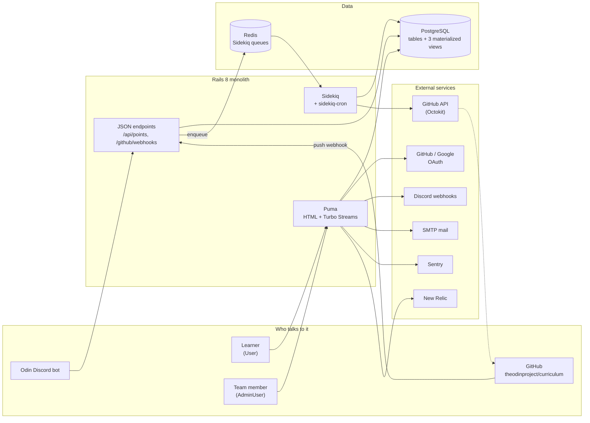

The surprising part is where lesson text comes from. Nobody writes it in this
database. It lives in a separate repo called `theodinproject/curriculum`. When
someone merges a change there, GitHub sends a webhook to this app. A background
job then fetches the file over the GitHub API and stores the rendered HTML.

From `app/models/github/lesson_content_importer.rb`:

```ruby
Octokit.contents('theodinproject/curriculum', path: lesson.github_path)
```

---

## 2. Request pipeline

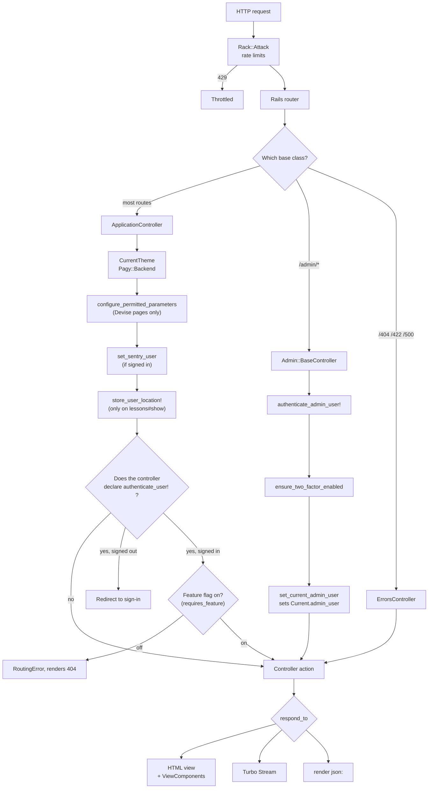

Rack::Attack sits in front of everything and limits how often an IP can hit the
risky endpoints. It covers sign-in, sign-up, password reset, admin sign-in, and
flag reports. Most are 5 requests per 20 seconds.

The app has three separate controller stacks, and they do not share filters.
`ApplicationController`, `Admin::BaseController`, and `ErrorsController` each
inherit from `ActionController::Base` directly.

That split is deliberate for the admin side. It has its own Devise scope, its own
two-factor gate, and no `current_user` at all. It also stores the signed-in admin
in `Current.admin_user`, which is a `CurrentAttributes` class that holds
per-request state.

`store_user_location!` is narrower than the name suggests. It only fires on one
page:

```ruby
def storable_location?
  controller_path == 'lessons' && action_name == 'show'
end
```

So the app remembers where you were for the purpose of one redirect. If you hit a
lesson while signed out, signing in returns you to that lesson.

---

## 3. Controller hierarchy

```mermaid
classDiagram
  class ActionController_Base
  class ApplicationController {
    +CurrentTheme
    +Pagy::Backend
    +set_sentry_user
    +store_user_location!
  }
  class Admin_BaseController {
    +authenticate_admin_user!
    +ensure_two_factor_enabled
    +set_current_admin_user
  }
  class ErrorsController

  ActionController_Base <|-- ApplicationController
  ActionController_Base <|-- Admin_BaseController
  ActionController_Base <|-- ErrorsController

  ApplicationController <|-- StaticPagesController
  ApplicationController <|-- PathsController
  ApplicationController <|-- CoursesController
  ApplicationController <|-- LessonsController
  ApplicationController <|-- UsersController
  ApplicationController <|-- NotificationsController
  ApplicationController <|-- ThemesController
  ApplicationController <|-- SitemapController
  ApplicationController <|-- InterviewSurveysController
  ApplicationController <|-- Api_PointsController
  ApplicationController <|-- Github_WebhooksController
  ApplicationController <|-- Lessons_CompletionsController
  ApplicationController <|-- Lessons_ProjectSubmissionsController
  ApplicationController <|-- Lessons_CourseContentsController
  ApplicationController <|-- Lessons_PreviewsController
  ApplicationController <|-- ProjectSubmissions_FlagsController
  ApplicationController <|-- ProjectSubmissions_LikesController
  ApplicationController <|-- Users_PathsController
  ApplicationController <|-- Users_ProgressController
  ApplicationController <|-- Users_ProfilesController
  ApplicationController <|-- Courses_ProgressController
  ApplicationController <|-- Guides_CommunityController
  ApplicationController <|-- Guides_InstallationsController

  Admin_BaseController <|-- Admin_DashboardController
  Admin_BaseController <|-- Admin_FlagsController
  Admin_BaseController <|-- Admin_LearnersController
  Admin_BaseController <|-- Admin_AnnouncementsController
  Admin_BaseController <|-- Admin_TeamMembersController
  Admin_BaseController <|-- Admin_ProfileController
  Admin_BaseController <|-- Admin_Reports

  class Devise_Controllers
  Devise_Controllers <|-- Users_SessionsController
  Devise_Controllers <|-- Users_RegistrationsController
  Devise_Controllers <|-- Users_PasswordResetsController
  Devise_Controllers <|-- Users_OmniauthCallbacksController
  Devise_Controllers <|-- Admin_SessionsController
  Devise_Controllers <|-- Admin_PasswordsController
  Devise_Controllers <|-- Admin_InvitationsController
```

Devise is the authentication gem. Its controllers inherit from Devise's own base
classes, not from `ApplicationController`, so they sit in their own branch above.

---

## 4. Endpoint map

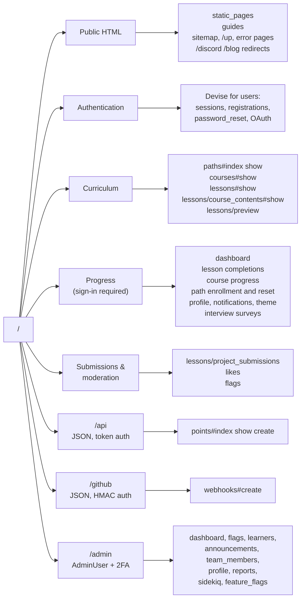

### 4.1 The JSON API

These four endpoints are the only ones that return JSON.

| Method | Path | Handler | Auth |
|---|---|---|---|
| `GET` | `/api/points` | `Api::Points#index` | HTTP token, compared to `ODIN_BOT_ACCESS_TOKEN` |
| `GET` | `/api/points/:id` | `Api::Points#show` | Same token. `:id` is a Discord id, not a database id |
| `POST` | `/api/points` | `Api::Points#create` | Same token. Calls `find_or_create_by(discord_id:)` |
| `POST` | `/github/webhooks` | `Github::Webhooks#create` | HMAC signature, checked against `GITHUB_WEBHOOK_SECRET` |

Both controllers skip CSRF checks, which is correct. CSRF protection defends
form submissions from a browser. These callers are a Discord bot and GitHub, and
they authenticate with a token instead.

The points controller compares tokens in constant time, so an attacker cannot
guess the token one character at a time by measuring how long the check takes:

```ruby
authenticate_or_request_with_http_token do |token|
  ActiveSupport::SecurityUtils.secure_compare(token, ENV['ODIN_BOT_ACCESS_TOKEN'])
end
```

### 4.2 Public HTML

| Method | Path | Handler |
|---|---|---|
| `GET` | `/` | `static_pages#home` when signed out. Redirects to `/dashboard` when signed in |
| `GET` | `/home` `/about` `/faq` `/team` `/terms_of_use` `/success_stories` | `static_pages` |
| `GET` | `/privacy-policy` | `static_pages#privacy_policy`. The path uses a dash, the action uses an underscore |
| `GET` | `/contributing` `/support_us` | `static_pages`. No action is defined, so Rails renders the template directly |
| `GET` | `/sitemap` | `sitemap#index`, always XML |
| `GET` | `/up` | `rails/health#show`, the health check for the load balancer |
| `ALL` | `/404` `/422` `/500` | `errors#not_found`, `#unprocessable_entity`, `#internal_server_error` |
| `GET` | `/guides/installations` | `guides/installations#index` |
| `GET` | `/guides/community` | `guides/community#show` |
| `GET` | `/guides/community/before_asking` and 4 siblings | `guides/community`. Also `how_to_ask`, `expectations`, `rules`, `how_to_help` |
| `GET` | `/discord` `/blog` | Redirects to `ODIN_CHAT_URL` and `ODIN_BLOG_URL` |
| `GET` | `/lookbook` | ViewComponent previews. Development only |

### 4.3 Authentication

The learner side uses Devise with these modules: `database_authenticatable`,
`registerable`, `recoverable`, `rememberable`, `trackable`, `validatable`, and
`omniauthable`. Two common modules are missing. There is no `confirmable`, so
nobody has to confirm an email address. There is no `lockable`, so failed
sign-ins never lock an account. Rack::Attack handles that instead.

The route declaration renames the password paths:

```ruby
devise_for(
  :users,
  module: 'users',
  controllers: { passwords: 'users/password_resets' },
  path_names: { password: 'password_reset' }
)
```

| Method | Path | Handler |
|---|---|---|
| `GET` `POST` | `/users/sign_in` | `users/sessions#new` `#create` |
| `DELETE` | `/users/sign_out` | `users/sessions#destroy` |
| `GET` `POST` | `/users/sign_up`, `/users` | `users/registrations#new` `#create` |
| `GET` `PATCH` `DELETE` | `/users/edit`, `/users` | `users/registrations#edit` `#update` `#destroy` |
| `GET` `POST` `PATCH` | `/users/password_reset/*` | `users/password_resets` |
| `GET` `POST` | `/users/auth/github`, `/users/auth/google` | OAuth starts here |
| `GET` `POST` | `/users/auth/:provider/callback` | `users/omniauth_callbacks#github` |
| `GET` | `/auth/failure` | `users/omniauth_callbacks#failure` |
| `GET` `GET` `DELETE` | `/sign_in` `/sign_up` `/sign_out` | Short aliases, added via `devise_scope` |

### 4.4 Curriculum

| Method | Path | Handler | Notes |
|---|---|---|---|
| `GET` | `/paths` | `paths#index` | |
| `GET` | `/paths/:id` | `paths#show` | `:id` is a slug. Redirects to the course if the path has only one |
| `GET` | `/paths/:path_id/courses/:id` | `courses#show` | Slug too. Sends a no-store header |
| `GET` | `/lessons/:id` | `lessons#show` | Slug too. Sends a no-store header |
| `GET` | `/lessons/:lesson_id/course_contents` | `lessons/course_contents#show` | The sidebar fragment |
| `POST` | `/lessons/preview` | `lessons/previews#create` | No sign-in required |
| `GET` | `/lessons/preview` | `lessons/previews#show` | No sign-in required |
| `POST` | `/lessons/preview/share` | `lessons/previews/share#create` | |

The `:id` in those three routes is a slug, not a number, so a lesson URL reads
`/lessons/installing-ruby`. That comes from the FriendlyId gem:

```ruby
friendly_id :title, use: %i[slugged history finders]
```

`history` is the useful part. It keeps old slugs in a table, so renaming a lesson
does not break links people already saved.

Three of those actions turn off browser caching:

```ruby
def set_cache_control_header_to_no_store
  response.cache_control.replace(no_store: true)
end
```

They need it because whether a lesson is complete is baked into the HTML. Turbo
keeps a cached copy of pages you have visited and shows it instantly when you go
back. Without the header you would see a stale checkmark.

### 4.5 Progress

Every route here calls `authenticate_user!`, except the one noted.

| Method | Path | Handler |
|---|---|---|
| `GET` | `/dashboard` | `users#show` |
| `POST` `DELETE` | `/lessons/:lesson_id/completion` | `lessons/completions#create` `#destroy` |
| `GET` | `/courses/progress/:id` | `courses/progress#show` |
| `POST` | `/users/paths` | `users/paths#create`, enrolls in a path |
| `DELETE` | `/users/progress/:id` | `users/progress#destroy`, resets progress on a path |
| `GET` `PATCH` | `/users/profile/edit`, `/users/profile` | `users/profiles#edit` `#update` |
| `GET` `PATCH` | `/notifications`, `/notifications/:id` | `notifications#index` `#update` |
| `PATCH` | `/themes` | `themes#update`. **No sign-in required.** See §8 |
| `GET` `POST` | `/interview_surveys/new`, `/interview_surveys` | `interview_surveys`. Hidden behind a feature flag |

The survey pages use a feature flag, which is a switch that turns a feature on
for some users without a deploy. This app uses Flipper for that:

```ruby
requires_feature :survey_feature
```

If the flag is off, the concern raises a routing error and the user sees a 404.

### 4.6 Submissions and moderation

| Method | Path | Handler |
|---|---|---|
| `GET` | `/lessons/:lesson_id/project_submissions` | `lessons/project_submissions#index` |
| `GET` | `/lessons/:lesson_id/project_submissions/new` | `#new` |
| `POST` | `/lessons/:lesson_id/project_submissions` | `#create` |
| `GET` | `/lessons/:lesson_id/project_submissions/:id/edit` | `#edit` |
| `PATCH` `DELETE` | `/lessons/:lesson_id/project_submissions/:id` | `#update` `#destroy` |
| `PATCH` | `/project_submissions/:project_submission_id/like` | `project_submissions/likes#update` |
| `GET` `POST` | `/project_submissions/:project_submission_id/flags/new`, `/flags` | `project_submissions/flags#new` `#create` |
| `GET` | `/project_submissions` | Declared, but no controller exists. See §8 |

`Lessons::ProjectSubmissionsController` runs three filters in order:
`authenticate_user!`, then `set_lesson`, then `can_add_solution`. Every write
action replies in both HTML and Turbo Stream. That is what makes the submission
list update without a page reload.

### 4.7 Admin, under `/admin`

Admins are a separate model, `AdminUser`, with its own Devise scope:

```ruby
devise_for :admin_users, path: :admin, module: :admin
```

Its modules are `two_factor_authenticatable`, `invitable`, `recoverable`,
`trackable`, `timeoutable`, and `validatable`. `registerable` is absent, so
nobody can sign themselves up. Accounts arrive only by invitation.

| Method | Path | Handler |
|---|---|---|
| `GET` `POST` `DELETE` | `/admin/sign_in`, `/admin/sign_out` | `admin/sessions` |
| `GET` `POST` `PATCH` | `/admin/password/*` | `admin/passwords` |
| `GET` `POST` `PUT` | `/admin/invitation/*` | `admin/invitations` |
| `GET` | `/admin`, `/admin/dashboard` | `admin/dashboard#show` |
| `GET` `POST` | `/admin/two_factor_authentication` | `admin/two_factor_authentication` |
| `GET` `GET` `PATCH` | `/admin/flags`, `/admin/flags/:id` | `admin/flags#index` `#show` `#update` |
| `GET` `GET` `DELETE` | `/admin/learners`, `/admin/learners/:id` | `admin/learners#index` `#show` `#destroy` |
| all | `/admin/announcements` | `admin/announcements`, full CRUD |
| all | `/admin/team_members` | `admin/team_members`, full CRUD |
| `GET` | `/admin/team` | Another name for `admin/team_members#index` |
| `GET` | `/admin/team_members/activities` | `admin/team_members/activities#index` |
| `POST` | `/admin/team_members/:team_member_id/password_resets` | Sends a reset email |
| `POST` | `/admin/team_members/:team_member_id/resend_invitation` | Resends the invite |
| `PATCH` | `.../deactivation`, `.../reactivation` | Moves the account between states |
| `GET` `PATCH` | `.../role/edit`, `.../role` | Changes moderator, maintainer, or core |
| `PATCH` | `.../two_factor_reset` | Clears their 2FA setup |
| `GET` `PATCH` | `/admin/profile/edit`, `/admin/profile` | `admin/profile` |
| `PATCH` | `/admin/profile/password` | `admin/profile/password#update` |
| `GET` | `/admin/reports/lesson_completions` | `admin/reports/lesson_completions#show` |
| `GET` | `/admin/reports/paths/:id` | `admin/reports/paths#show` |
| `GET` | `/admin/reports/users` | `admin/reports/users#index` |
| mount | `/admin/sidekiq` | Sidekiq's own web UI |
| mount | `/admin/feature_flags` | Flipper's own web UI |

Account status is a state machine, built with AASM. An admin account is
`pending`, `activated`, `deactivated`, or `pending_reactivation`, and the
deactivation and reactivation routes move it between those states. The gem
enforces which moves are legal.

The two mounted UIs are worth a second look:

```ruby
authenticate :admin_user do
  mount Sidekiq::Web => '/sidekiq'
  mount Flipper::UI.app(Flipper) => '/feature_flags', as: :feature_flags
end
```

`authenticate` is a router-level check from Warden, the library Devise sits on.
It confirms an admin is signed in and nothing more. Requests to these two paths
never reach `Admin::BaseController`, so the 2FA gate never runs on them. See §8.

### 4.8 Legacy redirects

These live in `config/routes/redirects.rb` and keep old bookmarks working.

| Path | Goes to |
|---|---|
| `/courses/web-development-101(/lessons/:id)` | `/paths/foundations` |
| `/paths/:path_id/courses/:course_id/lessons/:id` | `Redirectors::NestedLessonRedirector` |

The second one is a plain object that Rails calls to work out the new URL.
Lessons used to be nested under a path and a course. Now they live at
`/lessons/:id`, so the old URL has to be translated rather than mapped.

---

## 5. Domain model

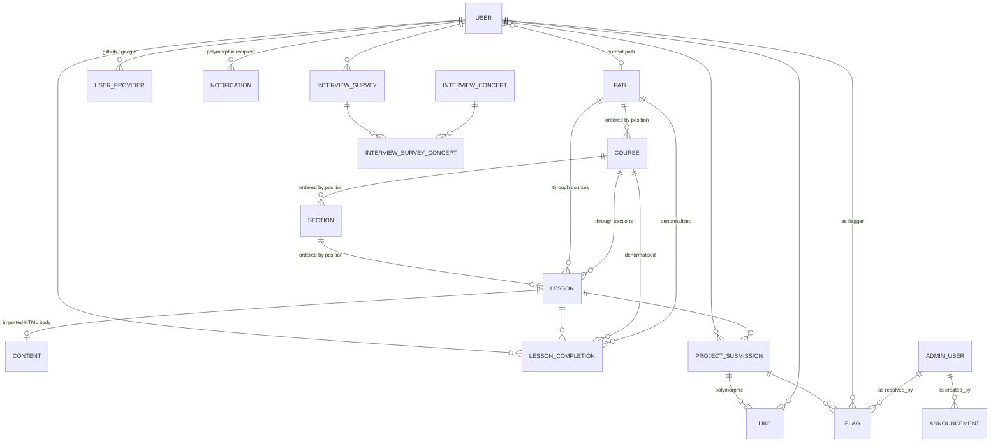

The curriculum is four levels deep: a path holds courses, a course holds
sections, and a section holds lessons. Each level is ordered by a `position`
column.

Some tables connect to nothing else. `Point` is keyed on a Discord id and is
driven only by `/api/points`. `LessonPreview` and `SuccessStory` stand alone too.
So do the three read-only report models under `Reports::`.

Three details shape a lot of the code.

**`LessonCompletion` stores four foreign keys, not one.** It has `lesson_id`,
plus `course_id` and `path_id` copied down from the lesson. Copying data like
this is called denormalising. It costs correctness risk, because the copies can
drift. It buys read speed, because a progress bar can count completions for a
path with one query instead of walking section, course, then path.

**A like updates two rows.** `Like` is polymorphic, which means one table can
point at several kinds of record. It also uses a counter cache:

```ruby
belongs_to :likeable, polymorphic: true, counter_cache: true
```

A counter cache keeps a running total in a column on the parent, so showing a
like count needs no `COUNT` query. Rails bumps it for you on create and destroy.
There is a note on this in [`concepts/counter-cache.md`](concepts/counter-cache.md).

**Enrolling in a path also updates a count on the path.** From
`app/models/user.rb:23`:

```ruby
belongs_to :path, optional: true, counter_cache: true
```

`optional: true` matters here. A user does not have to have a path, so this
association skips the presence validation Rails would otherwise add.

### Report views

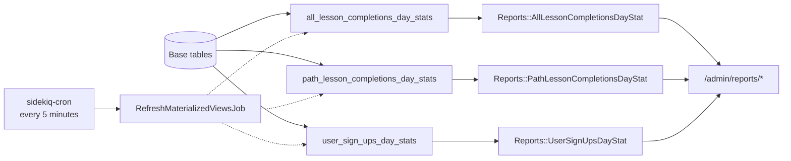

The admin reports do not query the main tables. They read three materialized
views. A materialized view is a query whose results Postgres stores on disk, so
reading it is as cheap as reading a table. The trade is that the data goes stale
until something refreshes it.

The SQL lives in `db/views/`, managed by the Scenic gem. The models include a
`MaterializedView` concern that marks them `readonly?` and adds a class method to
refresh:

```ruby
def refresh
  Scenic.database.refresh_materialized_view(table_name, concurrently: false, cascade: false)
end
```

A cron job runs that every 5 minutes, so admin report numbers can be up to 5
minutes behind.

---

## 6. Async work and integrations

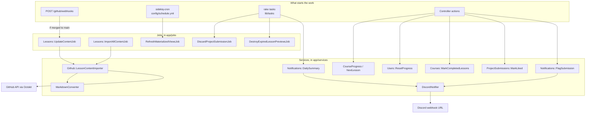

Only one job is on a schedule inside this repo. `config/schedule.yml` has a
single entry, `RefreshMaterializedViewsJob`, every 5 minutes.

The other three periodic jobs run from rake tasks in `lib/tasks/`. Nothing in
this repo says how often. That timing lives in whatever scheduler the deploy
platform provides, so you cannot learn the cadence by reading the code.

The webhook controller is short, and `Github::PushEvent` does the deciding:

```ruby
def github_push(payload)
  event = ::Github::PushEvent.new(payload)

  Lessons::UpdateContentJob.perform_later(event.modified_urls) if event.merged_to_main?
end
```

---

## 7. Key request flows

### 7.1 Marking a lesson complete

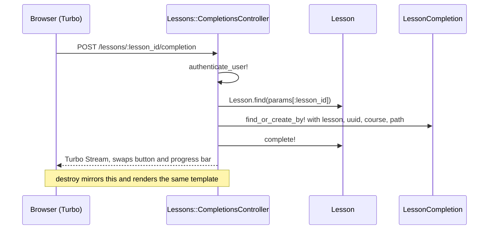

Two things stand out.

`Lesson#complete!` looks like it writes to the database. It does not:

```ruby
def complete!
  self.completed = true
end
```

It sets an attribute in memory. The name ends in a bang, which in Ruby usually
means "this one is the dangerous version". Here it just flips a flag so the
shared partials render the completed state. Nothing is saved.

The completion row is created with `find_or_create_by!`, so clicking twice
creates one row, not two. It stores five columns: the lesson, the lesson's
`identifier_uuid`, the course, the path, and the user.

### 7.2 Flagging a submission

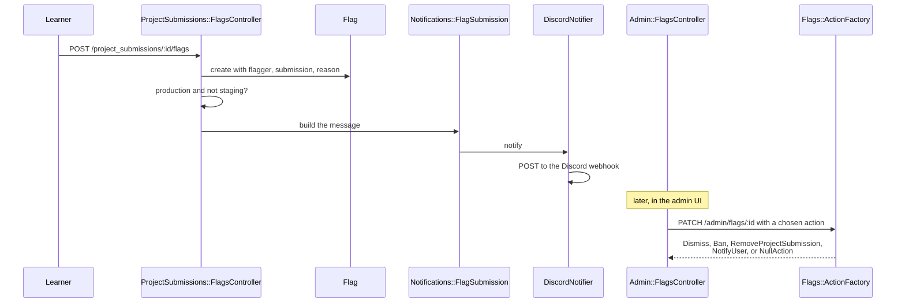

The Discord message only sends in real production:

```ruby
def discord_notifications_enabled?
  Rails.env.production? && ENV['STAGING'].blank?
end
```

That is an environment check, not a feature flag. Staging shares the production
Rails environment, so the extra `STAGING` check is what keeps staging from
pinging the real moderator channel.

When an admin resolves a flag, `Flags::ActionFactory` turns their choice into an
object that knows how to carry it out:

```ruby
{
  dismiss: Flags::Actions::Dismiss,
  ban: Flags::Actions::Ban,
  removed_project_submission: Flags::Actions::RemoveProjectSubmission,
  notified_user: Flags::Actions::NotifyUser
}.fetch(@action, Flags::Actions::NullAction)
```

The second argument to `fetch` is the default. An unknown action returns
`NullAction`, which does nothing on purpose. That is a null object: an object
that satisfies the interface and no-ops, so callers never need an `if` to check
for a missing case.

### 7.3 Curriculum text arriving from GitHub

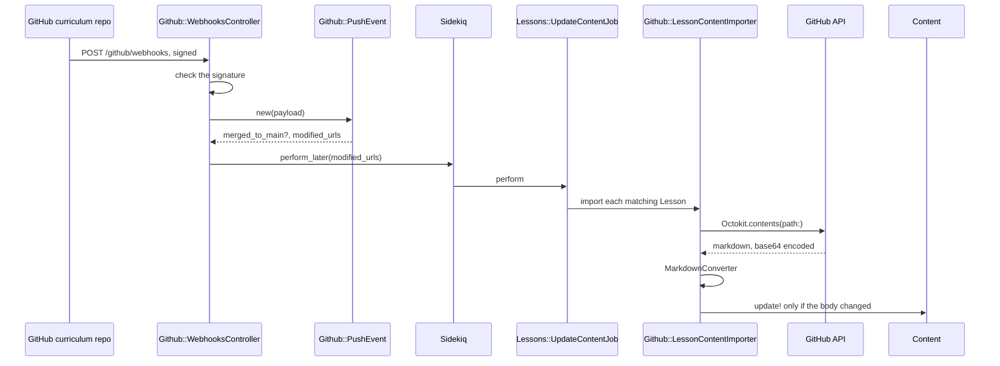

The webhook handler does almost nothing itself. It verifies the signature,
decides whether the push matters, and hands off. That keeps the response fast,
which webhook senders expect, and it means a slow GitHub API call cannot time
out the request.

The importer compares before writing:

```ruby
def content_needs_updated?
  content.body != content_converted_to_html
end
```

So a push that touches a file without changing its rendered output writes
nothing.

### 7.4 Signing in with GitHub or Google

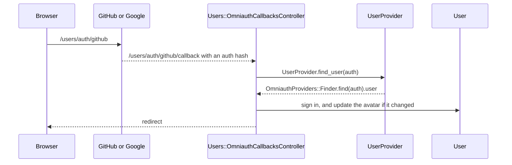

One controller handles both providers, using an alias:

```ruby
alias google github
```

If the lookup returns a user who was never saved, the controller stashes the auth
hash in the session and sends them to the sign-up form instead. That covers a
first-time OAuth visitor who still needs an account.

---

## 8. Things worth noticing

These come from reading the code. I have not confirmed them against a running
app, so treat them as leads, not bug reports.

**1. `GET /project_submissions` has no controller.** The route file declares
`resources :project_submissions, only: :index`, but
`app/controllers/project_submissions_controller.rb` does not exist. Every view
and spec links to `lesson_project_submissions_path` instead. The outer
`resources` block looks like it exists only to create the
`/project_submissions/:id/...` prefix for likes and flags. The `only: :index`
part appears to be left over.

**2. `ThemesController` does not require sign-in.** Its neighbours in the same
route block all do. That is probably intended, since light and dark mode should
work before you have an account. It explains why the controller caches the
previous theme rather than saving it on the user.

**3. `/admin/sidekiq` and `/admin/feature_flags` skip the 2FA gate.** They are
mounted at the router inside `authenticate :admin_user`, so being signed in is
enough. `ensure_two_factor_enabled` lives in `Admin::BaseController`, and these
requests never reach it. An admin who has not set up 2FA can still open the job
queue and the feature flag switches.

**4. `Api::Points#index` trusts its pagination params.** `params[:limit]` and
`params[:offset]` go straight into the query with no maximum:

```ruby
Point.order(points: :desc).limit(params[:limit]).offset(params[:offset])
```

A caller with the token can ask for every row at once.

**5. `/lessons/preview` needs no sign-in.** Anyone can render preview content and
create a share link. `LessonPreview.expired` plus the cleanup job is the only
thing limiting how long those live.

**6. `Point` has no link to `User`.** The Discord leaderboard is keyed on
`discord_id` alone. You cannot join points to a learner in SQL.

**7. Only one job's schedule is visible in this repo.** The other three run from
rake tasks. If you need to know how often they fire, the answer is in the deploy
platform, not here.

---

## Where to go next

- The curriculum hierarchy and progress: `app/models/path.rb`, `course.rb`,
  `section.rb`, `lesson.rb`, and `app/services/course_progress.rb`
- The Turbo-heavy write path:
  `app/controllers/lessons/project_submissions_controller.rb`
- The separate admin stack: `app/controllers/admin/base_controller.rb`
- Objects that stand in for a case statement: `app/models/flags/action_factory.rb`
  and `app/models/flags/actions/`
